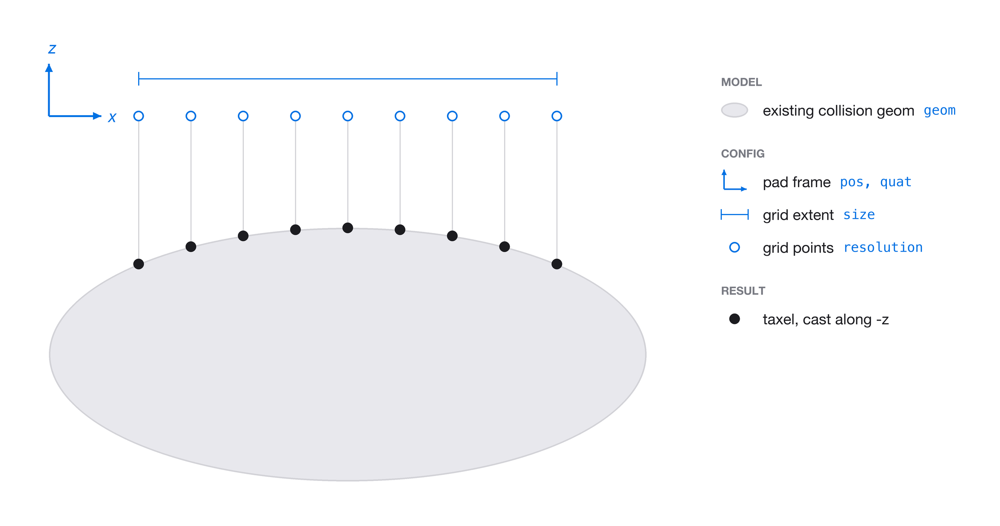
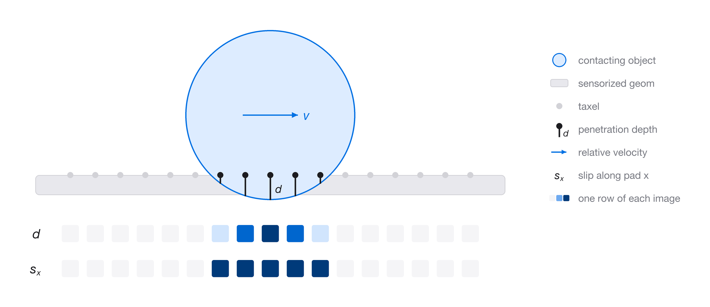

.. _tactile_sensor:

Tactile Sensor
==============

``TactileSensor`` places a grid of taxels on the surface of a collision
geom and reports, at every taxel, how deep a touching object reaches
and how fast it slides. The readings come back as images over the
taxel grid. It wraps MuJoCo's
`tactile sensor <https://mujoco.readthedocs.io/en/stable/XMLreference.html#sensor-tactile>`_.

.. raw:: html

   <figure class="align-center" style="max-width: 480px; margin-left: auto; margin-right: auto;">
     <video controls style="display: block; width: 100%; height: auto;">
       <source src="../../_static/tactile/braille_demo.mp4" type="video/mp4">
     </video>
     <figcaption>
       
The Sharpa Wave hand reads a braille
       plaque with the tactile sensor on its index fingertip. Each braille
       cell is decoded from the depth readings.

     </figcaption>
   </figure>

Quick start
-----------

.. code-block:: python

    from mjlab.sensor import ObjRef, TactileSensorCfg

    # A 10 x 7 taxel grid on a fingertip pad.
    tactile_cfg = TactileSensorCfg(
        name="index_tactile",
        geom=ObjRef(type="geom", name="right_index_pad_collision", entity="robot"),
        pos=(0.017, 0.0, 0.0),
        quat=(0.7071, 0.7071, 0.0, 0.0),
        size=(0.016, 0.010),
        resolution=(10, 7),
    )

    scene_cfg = SceneCfg(
        entities={"robot": robot_cfg},
        sensors=(tactile_cfg,),
    )

    # Access at runtime.
    data = env.scene["robot/index_tactile"].data
    data.depth  # [B, 10, 7] penetration depth (m)
    data.slip   # [B, 10, 7, 2] sliding speed along the pad's x and y (m/s)

The sensor name is prefixed with the geom's entity, so ``"index_tactile"``
on entity ``"robot"`` becomes ``"robot/index_tactile"``.

Placing the taxels
------------------

The geom already exists in the model. The configuration does not change
it; it only defines where the taxels go. You describe a flat grid in a
*pad frame* and the sensor projects that grid onto the geom's surface.

- ``pos`` and ``quat`` place the pad frame in the geom's body frame.
  The pad's +z axis points out of the surface.
- ``size`` is the extent of the grid along the pad's x and y axes, in
  meters.
- ``resolution`` is the number of taxels along the pad's x and y axes.

When the scene is built, each grid point is cast along the pad's -z
axis. The taxel is placed where that ray first hits the geom's
collision surface.

   The configuration (blue) defines a flat grid in the pad frame. Each
   grid point is cast along -z onto the existing collision geom (grey).
   The landing points are the taxels (black).

For mesh geoms the collision surface is the mesh's convex hull, which is
what MuJoCo collides against. Primitive geoms (spheres, capsules, boxes,
cylinders, ellipsoids) use their exact shape. Planes and height fields
are not supported.

Each taxel also gets its own frame: the surface normal at that point,
plus two tangents aligned with the pad's x and y axes. The two slip
channels are measured along these tangents.

If any ray misses the geom, scene construction raises a ``ValueError``
that reports how many taxels missed. Shrink ``size`` or move ``pos``
until the whole grid lands on the surface.

What each taxel measures
------------------------

At every physics step, MuJoCo finds the geoms in contact with the
sensor's body. For each of those geoms, it evaluates the geom's signed
distance at every taxel.

- **Depth** is how far the deepest touching geom reaches past the taxel,
  in meters. It is zero where nothing reaches the taxel.
- **Slip** is the speed of the touching geom relative to the sensor's
  body, projected onto the taxel's two tangents, in meters per second.
  Each channel is an absolute value, so it reports speed but not
  direction. It is zero wherever depth is zero. When several geoms
  touch the same taxel, their slip values add.

   An object presses into the pad while sliding at velocity *v*. Taxels
   under the object read a depth *d*. The same taxels also read a slip
   *s*\ :sub:`x` equal to *v* along the pad's x axis.

Contacts are soft in MuJoCo, so depth is the overlap the contact solver
allows between the two geoms. Its value depends on the contact
parameters (``solref`` and ``solimp``) of the pair. A softer contact
gives larger depths for the same force.

Output
------

``TactileData`` is a dataclass of two tensors laid out over the taxel
grid. Rows run along the pad's x axis and columns along its y axis.

.. list-table::
   :header-rows: 1
   :widths: 15 25 60

   * - Field
     - Shape
     - Description
   * - ``depth``
     - ``[B, R, C]``
     - Penetration depth at each taxel (m).
   * - ``slip``
     - ``[B, R, C, 2]``
     - Sliding speed along the pad's x axis (channel 0) and y axis
       (channel 1) (m/s).

``R`` and ``C`` are ``resolution[0]`` and ``resolution[1]``.

The world positions of the taxels are available from
``taxel_pos_w()``. It returns a ``[B, R * C, 3]`` tensor in row-major
grid order, so ``taxel_pos_w().view(B, R, C, 3)`` lines up with the
images.

Set ``cutoff`` to a positive value to clamp every reading, depth and
slip alike, to at most that value.

Fingertips on the Sharpa Wave hand
----------------------------------

``get_fingertip_tactile_cfgs`` returns one sensor configuration per
fingertip pad of the Sharpa Wave hand, named ``"{finger}_tactile"``.

.. code-block:: python

    from mjlab.asset_zoo.robots.sharpa_wave.sharpa_constants import (
        get_fingertip_tactile_cfgs,
        get_sharpa_robot_cfg,
    )

    scene_cfg = SceneCfg(
        entities={"robot": get_sharpa_robot_cfg("right")},
        sensors=get_fingertip_tactile_cfgs("right", resolution=(10, 7)),
    )

    index = env.scene["robot/index_tactile"].data.depth  # [B, 10, 7]

Each grid covers the palmar side of the fingertip's elastomer pad.
Pass ``fingers`` to sensorize a subset of the fingertips.

Visualization
-------------

Set ``debug_vis=True`` to draw every taxel as a small sphere in the
viewer. Taxels out of contact use ``viz.idle_color``. Taxels in contact
are colored from yellow to red by depth, reaching full red at
``viz.depth_range`` meters.

.. code-block:: python

    tactile_cfg = TactileSensorCfg(
        name="index_tactile",
        geom=ObjRef(type="geom", name="right_index_pad_collision", entity="robot"),
        debug_vis=True,
    )
    tactile_cfg.viz.depth_range = 0.0005  # Full red at 0.5 mm.

The Viser viewer lists each tactile sensor under its debug
visualization controls, so individual sensors can be shown or hidden.

Demos
-----

Two demos run the sensor on the Sharpa Wave hand.

.. code-block:: bash

    # A probe presses and slides on each fingertip; shows depth and slip images.
    uv run python scripts/demos/tactile_sensor.py

    # The index fingertip reads a braille plaque and decodes it from the depth.
    uv run python scripts/demos/tactile_braille.py
